# Database Studio

A desktop client for working with many databases and streaming systems in one window. You can browse schemas, write and run queries, edit data, compare schemas, manage users and privileges, back up and restore, read messages from Kafka, NATS and RabbitMQ, and browse Redis keys.

Built with **Tauri 2** (Rust backend) and **Svelte 5** (frontend). Runs on Windows, Linux and macOS.

> **Status:** beta (`0.1.0-beta.x`). It is usable day to day, but expect rough edges. The macOS build is not signed.

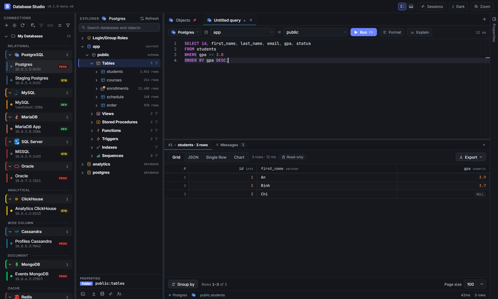

**Contents:** [Why Database Studio](#why-database-studio) · [Supported systems](#supported-systems) · [Feature tour](#feature-tour) · [Install](#install) · [Keyboard shortcuts](#keyboard-shortcuts) · [Running from source](#running-from-source) · [Project layout](#project-layout) · [Releasing](#releasing)

---

## Why Database Studio

- **One app for the whole stack.** A typical backend touches a relational database, a cache, a message broker and sometimes a search engine. Database Studio connects to all of them, so you do not switch between pgAdmin, SSMS, RedisInsight, Kafka UI and Kibana.
- **Each engine on its own terms.** Users and privileges follow each engine's own permission model, backups use each engine's own tools, and query plans are read from each engine's own `EXPLAIN` output. Nothing is forced into a lowest common denominator.
- **Plain language over jargon.** Query plans, errors and settings are explained in words ("Full table scan — reads every row of enrollments"), with the engine's original message kept next to it.
- **Safe by default.** Grid edits are only written when you click **Execute**, a diff shows the exact SQL first, and connections tagged **PROD** ask for confirmation before dangerous statements such as `DELETE` without `WHERE`.
- **Secure storage.** Passwords are stored encrypted (AES-256-GCM). SSH tunnels (password or private key) and SSL/TLS are supported for every engine.
- **AI-ready.** A built-in, local [MCP](https://modelcontextprotocol.io) server lets an AI agent explore and query the connections you choose — off by default, read-only unless you allow writes, and asking for approval first.

---

## Supported systems

| Category | Engines |
|---|---|
| Relational | PostgreSQL · MySQL · MariaDB · SQL Server · Oracle · SQLite · DuckDB · ClickHouse |
| Document / wide-column | MongoDB · FerretDB · Amazon DocumentDB · Cassandra · ScyllaDB |
| Search | Elasticsearch · OpenSearch |
| Cache | Redis · Valkey |
| Streaming | Kafka · Redpanda · NATS (JetStream) · RabbitMQ |

ScyllaDB, FerretDB, DocumentDB, Valkey, OpenSearch and Redpanda reuse the driver of their parent engine (Cassandra, MongoDB, Redis, Elasticsearch and Kafka respectively). The app detects which server it is talking to when you click **Test connection**.

---

## Feature tour

All screenshots below were taken in the app's built-in demo mode, so the connections, hosts and data are sample values (see [UI only, in a browser](#ui-only-in-a-browser-no-rust-needed)).

### Start screen

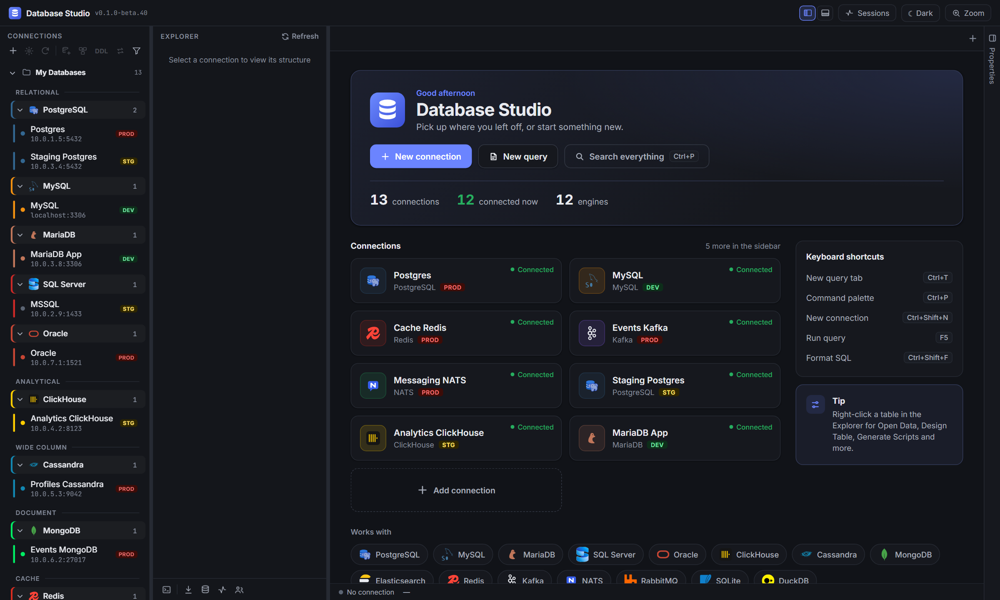

The app opens on a start screen. It lists your connections with their status and environment tag, gives one-click access to **New connection**, **New query** and **Search everything** (`Ctrl+P`), and shows the most useful keyboard shortcuts.

In the sidebar, connections are grouped by category and engine. Each connection carries an environment tag (**PROD**, **STG**, **DEV**, **LOCAL**) and a colored status dot, so it is always clear which server you are about to work on.

### Connecting

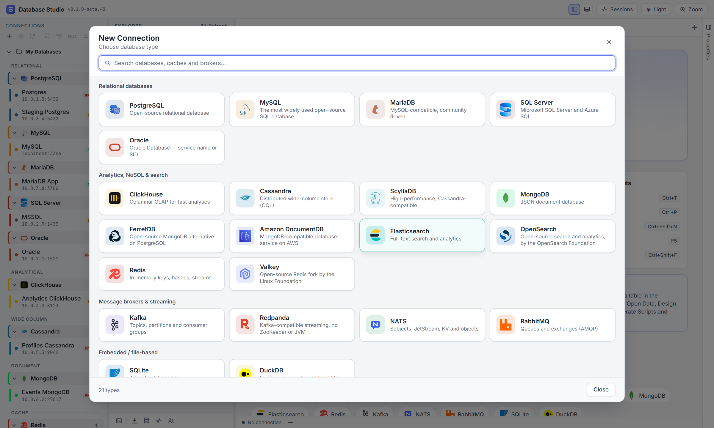

**New connection** (`Ctrl+Shift+N`) starts by choosing the engine. The list is searchable and grouped into relational databases; analytics, NoSQL and search; message brokers; and embedded databases.

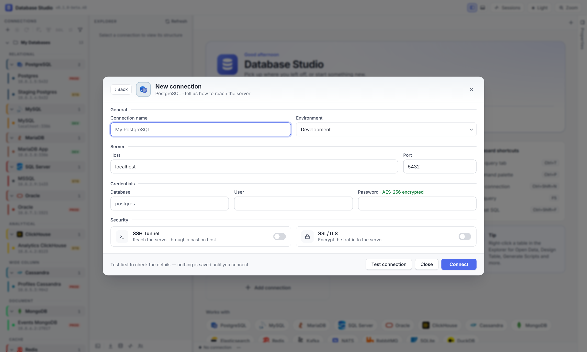

The form only asks for what that engine needs: host and port, credentials, database (or service name for Oracle, DB index for Redis, virtual host for RabbitMQ). Turn on **SSH Tunnel** to reach a server through a bastion host, or **SSL/TLS** to encrypt the traffic. **Test connection** checks the details and reports the server version before anything is saved; **Connect** saves the connection and opens it.

### Query editor

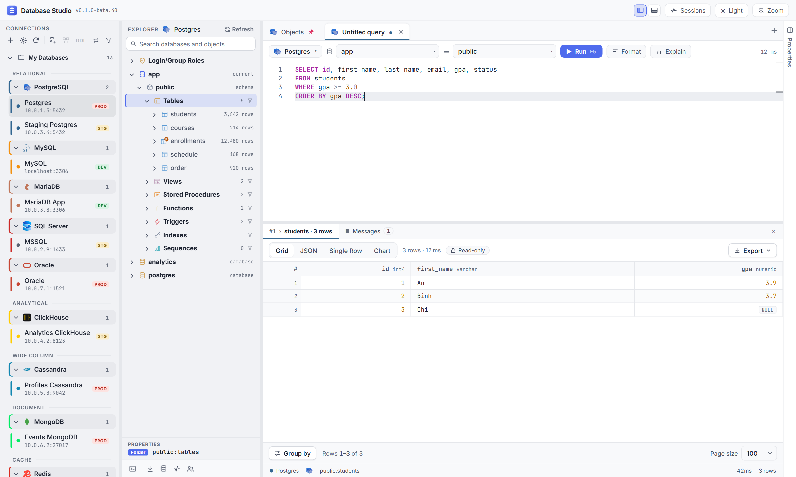

The editor is built on Monaco (the editor of VS Code), with syntax highlighting for each engine's own SQL dialect.

- **Autocomplete** suggests tables, columns (including through aliases such as `s.first_name`), functions with their signatures, and keywords. Names that clash with reserved words are quoted automatically in the right style for the engine.
- **Run** the whole script (`F5`) or only the statement at the cursor (`Ctrl+Enter`). Choose the database and schema for the tab from the toolbar.
- **Each tab has its own connection**, so a long query in one tab never blocks the others or the Explorer. `Esc` cancels the running query on the server.
- In a multi-statement script, only statements that return rows get a result tab. INSERT, UPDATE, DELETE and DDL are collected in the **Messages** tab, with rows affected, timing, and a clear explanation of any error (what failed, on which line, and how to fix it).
- An open transaction (`BEGIN` without `COMMIT`) is flagged in the toolbar with **Commit** and **Rollback** buttons, so you never forget one.
- Results can be shown as a grid, JSON, a single-row view or a chart.

### Query plans

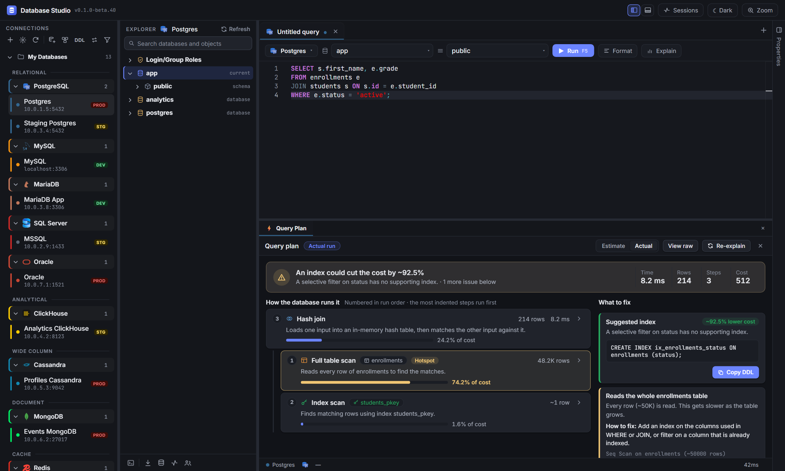

**Explain** (`Ctrl+Shift+E`) shows how the database runs the query, step by step and in run order. Each step is described in plain words with its share of the total cost, and the most expensive step is marked as a **Hotspot**. Switch between the **Estimate** and the **Actual** run (on engines that support `EXPLAIN ANALYZE`).

The right-hand column explains what to fix. When a filter has no supporting index, the app suggests one and shows the `CREATE INDEX` statement, ready to copy. **View raw** shows the engine's original plan.

### Editing data

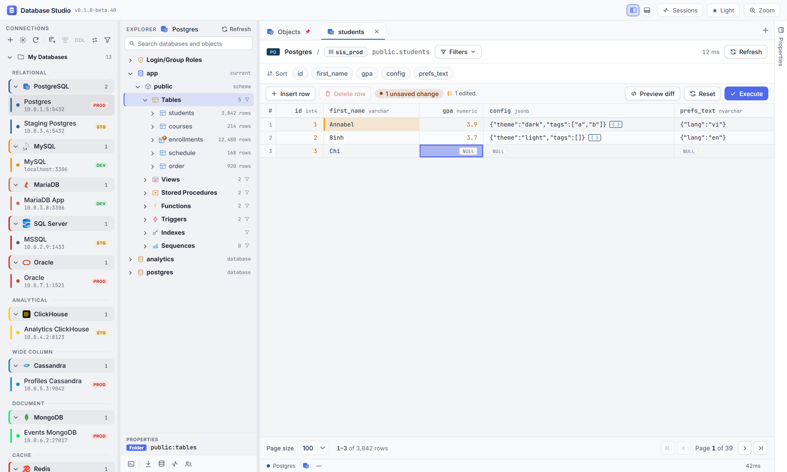

**Open Data** (double-click a table, or right-click → Open Data) shows the rows of a table, a page at a time, with sorting and filters.

- Double-click a cell to edit it. Edited cells are highlighted, and the toolbar counts what is pending: edited, new and to delete.
- **Insert row** adds a row; select rows in the `#` column and click **Delete row** to remove them.
- **Preview diff** shows the exact `INSERT`, `UPDATE` and `DELETE` statements. Nothing is written until you click **Execute**, and **Reset** throws the changes away.
- JSON columns open in a JSON editor with validation and formatting.
- Right-click the grid to copy cells, rows or the whole selection as CSV, JSON, SQL INSERT/UPDATE, Markdown or XML. **Export** writes CSV (UTF-8 with BOM, so Excel reads accents correctly), JSON, SQL, XML or a real Excel `.xlsx` file.

The result of a query is editable in the same way when it reads from a single table that has a primary key.

### Table Designer

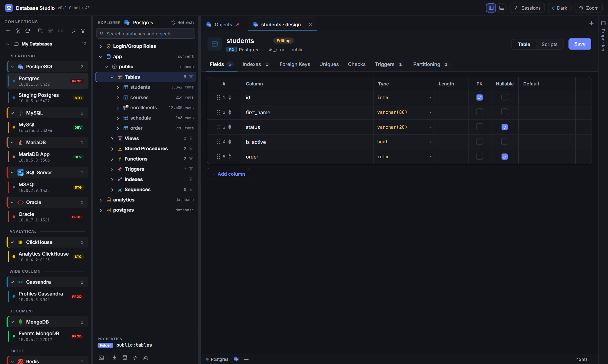

**Design Table** (right-click a table) opens the table definition in tabs: **Fields**, **Indexes**, **Foreign Keys**, **Uniques**, **Checks**, **Triggers** and **Partitioning**. Drag rows to reorder columns, pick types from the engine's full type list, and press **Save** (`Ctrl+S`). The **Scripts** view shows the generated `CREATE` or `ALTER` statements before they run.

It also creates new tables (right-click a schema → New Table) and can turn an existing table into a partitioned one where the engine allows it.

### ER diagram

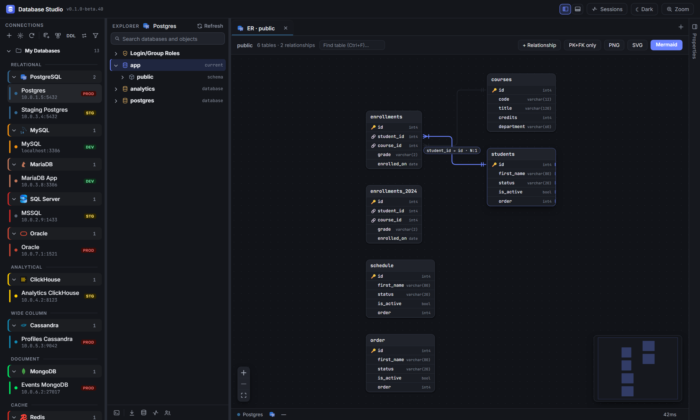

**View ER Diagram** (right-click a schema) draws the tables and their foreign keys, with crow's-foot notation showing one-to-many relationships. Hover a table to highlight its relationships. Drag tables to arrange them; the layout is saved. Drag from one column to another to create a foreign key, then **Save to DB**. Export the diagram to SVG or PNG.

### Schema Compare

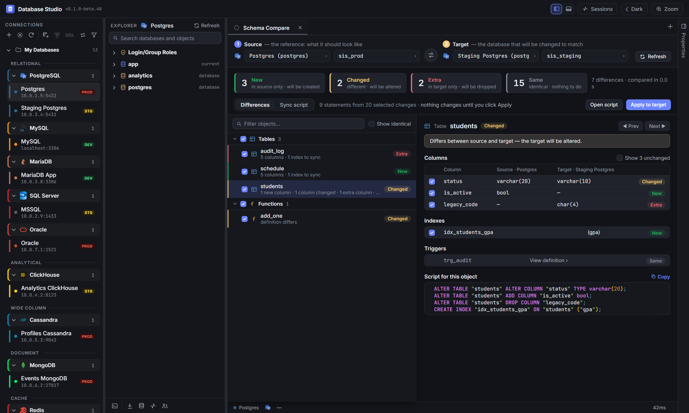

**Schema Compare** compares a source database with a target, for example staging against production, or two databases on the same server.

Differences are grouped into **New** (will be created in the target), **Changed** (will be altered), **Extra** (only in the target, will be dropped) and **Same**. Select an object to see what changed, column by column, and the script for that object alone. Tick the changes you want, review the **Sync script**, and **Apply to target**. Destructive statements are called out before anything runs.

### Users and privileges

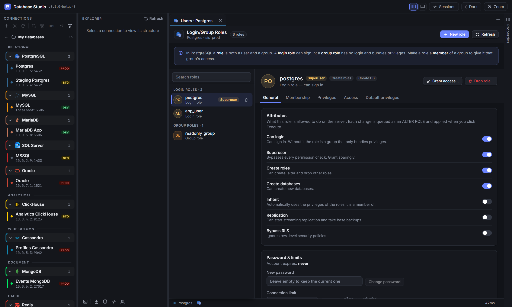

**Users & Privileges** (right-click a connection) manages logins, users and roles using each engine's own model: PostgreSQL roles and membership, MySQL `'user'@'host'` accounts, SQL Server logins and database users with `DENY`, ClickHouse, MongoDB, Oracle, Cassandra, RabbitMQ and Elasticsearch security.

- Create users and roles from a form, with a password generator.
- **Grant access…** walks through choosing the scope and an access level (Read-only, Read-Write, Full) and shows the SQL before it runs. A permission matrix is available for fine-grained control.
- The **Access** tab answers "what can this user see?": every database and schema the user can reach and the privileges it holds there, including those inherited from roles.
- Every change is queued as pending SQL and only applied when you click **Execute**.

### Backup and restore

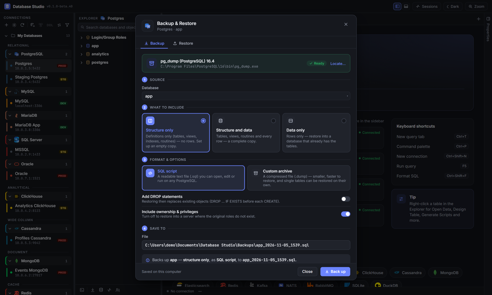

**Backup & Restore…** is in the right-click menu of every database. Choose **Structure only**, **Structure and data** or **Data only**, the output format (for example a readable `.sql` script or a compressed archive) and where to save it.

The app runs each engine's own tools: `pg_dump` / `pg_restore` / `psql`, `mariadb-dump`, `mongodump` / `mongorestore`, Oracle Data Pump, native `BACKUP` / `RESTORE` on SQL Server and ClickHouse, and built-in exports for Cassandra and Redis. The tools ship inside the installer, so there is nothing else to install. A progress window shows the percentage, the current table and the time left, with a **Stop** button.

### DuckDB workspace

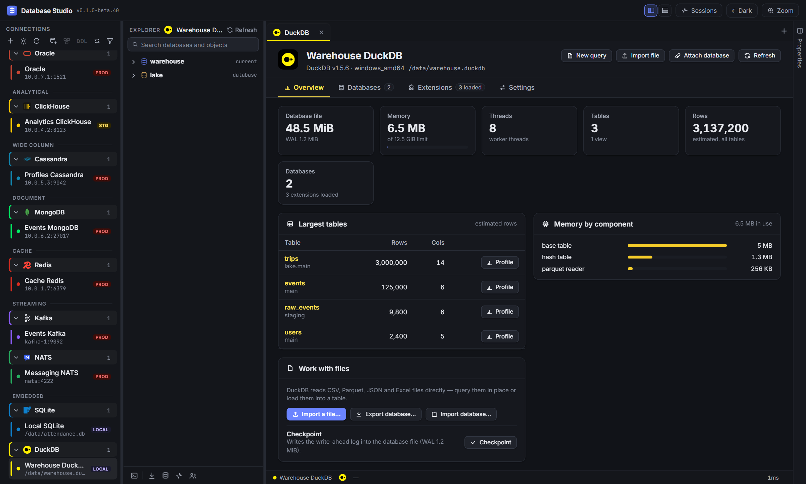

DuckDB connections get a workspace with an **Overview** (file size, memory, largest tables), attached **Databases**, **Extensions** (install and load) and **Settings**. **Import file** loads a CSV, Parquet, JSON or Excel file into a table or a view in three steps, and tables can be exported to Parquet, CSV or JSON. **Profile** shows a quick statistical summary of every column.

### Kafka

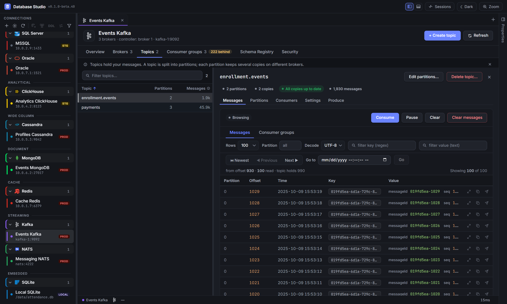

Selecting a Kafka (or Redpanda) connection opens a dedicated workspace with an **Overview** of the cluster health, **Brokers**, **Topics**, **Consumer groups** and **Schema Registry**.

Open a topic to read its messages a page at a time, jump to a point in time, view a message as JSON or hex, and produce new messages. Consumer groups show how far behind each partition is, and the **Change read position** wizard previews the new offsets before moving them. Topic settings are grouped and described in words. ACLs, SCRAM users and (for Redpanda) the cluster configuration are managed from the **Security** section.

### NATS

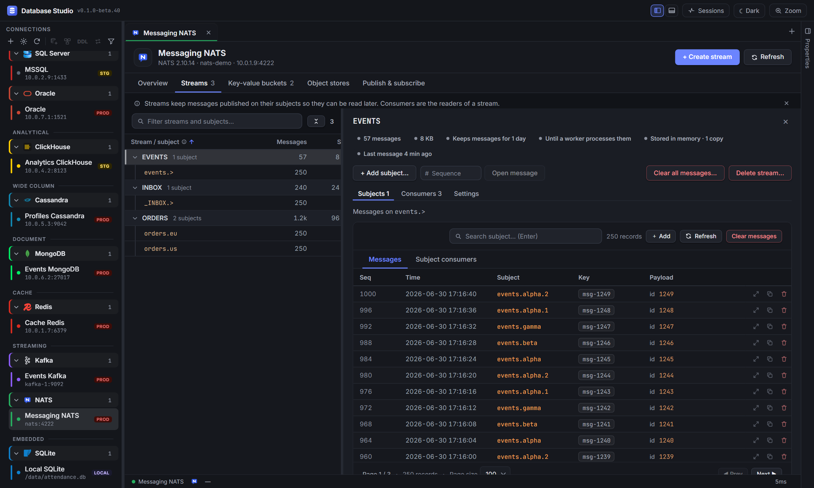

The NATS workspace shows the server and JetStream usage, **Streams** as a tree of streams and their subjects (with message counts per subject), **Key-value buckets** with the history of every key, **Object stores**, and **Publish & subscribe** for listening to subjects and sending messages or requests. Select a subject to read its messages, search by subject name, or open a message by its sequence number.

### RabbitMQ

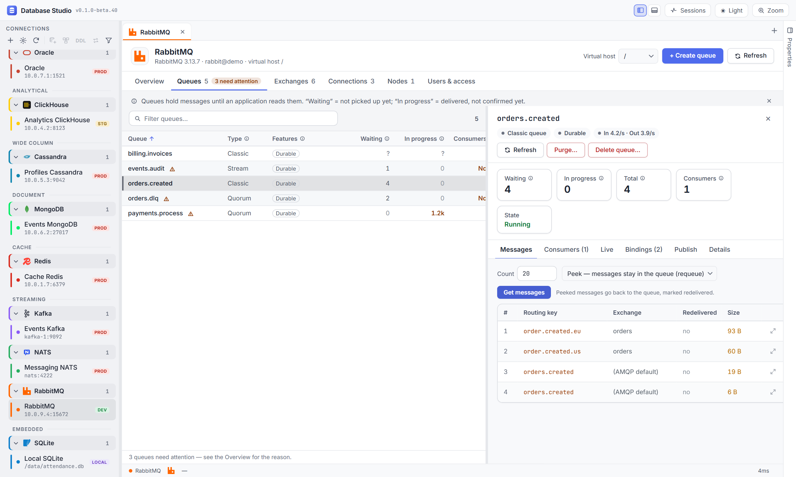

The RabbitMQ workspace works through the management API. It shows the message rates and queues that need attention, and lists **Queues**, **Exchanges**, **Connections** and **Nodes**. Open a queue to peek at messages (they stay in the queue), consume them, publish new ones, and manage its bindings. **Live** watches a queue or exchange as messages arrive, without taking them away from real consumers. **Users & access** manages users, permissions, policies and virtual hosts.

### Redis

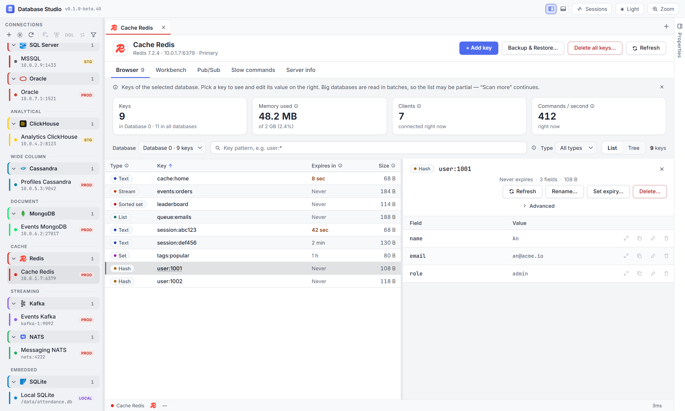

The Redis (and Valkey) browser lists keys as a flat list or a tree grouped by prefix, filters by pattern and type, and shows the selected key on the right. Strings, hashes, lists, sets, sorted sets and streams can be viewed and edited item by item, and each key's expiry can be set or removed. The workspace also has a **Workbench** for running commands, **Pub/Sub**, **Slow commands** and **Server info**.

### Elasticsearch and OpenSearch

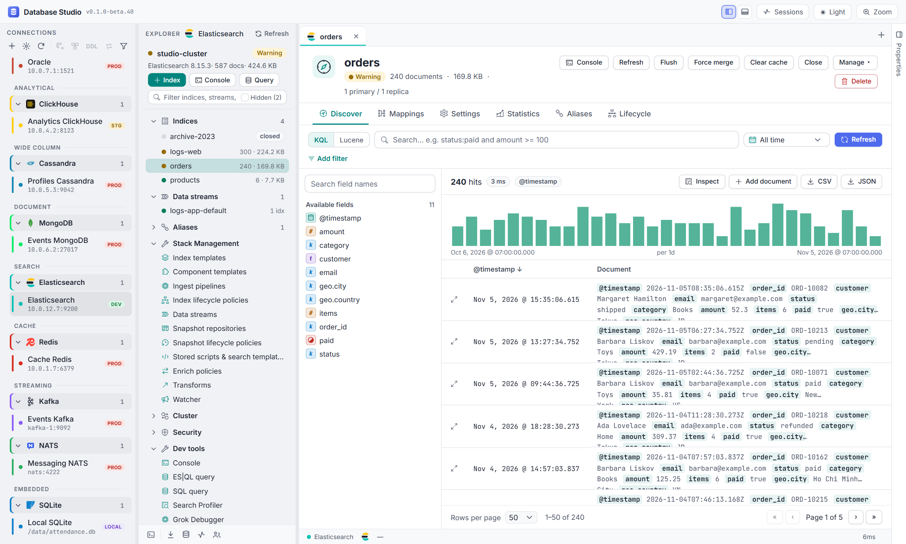

Elasticsearch and OpenSearch connections get a Kibana-style workspace:

- **Discover** each index with KQL or Lucene queries, a time picker, a histogram, filters and the field list. Documents can be added, edited and deleted.
- Index **Mappings**, **Settings**, **Statistics**, **Aliases** and **Lifecycle**, plus operations such as refresh, force merge, reindex, clone, shrink and split.
- **Stack Management**: index and component templates, ingest pipelines, lifecycle policies, data streams, snapshots, transforms and more.
- **Dev tools**: a console with autocomplete, ES|QL / SQL (PPL on OpenSearch), the Search Profiler, the Grok Debugger and Painless Lab.

### AI access (MCP server)

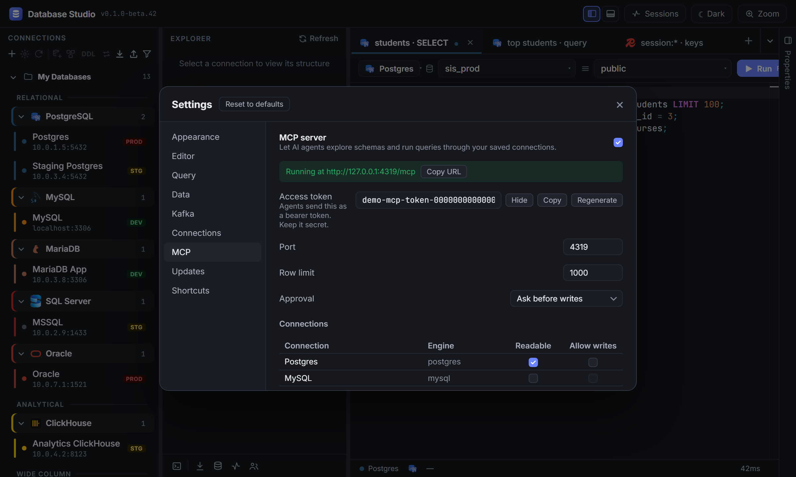

Database Studio can act as an [MCP](https://modelcontextprotocol.io) server so an AI agent (Claude Code, Claude Desktop, Cursor, …) can explore your schemas and run queries **through the connections you already set up** — no separate credentials, no copy‑pasting SQL.

It is **off by default** and built to stay safe:

- **Opt in per connection** — tick **Readable** to let an agent see and query a connection; tick **Allow writes** for INSERT/UPDATE/DELETE.
- **Local only** — the server binds to `127.0.0.1` and every request must carry the bearer **token** shown here.
- **Read‑capped** — queries return at most the **row limit** (default 1000), and an agent may run **one statement at a time**.
- **Approval before writes** — by default each write pauses for an in‑app Allow / Deny.

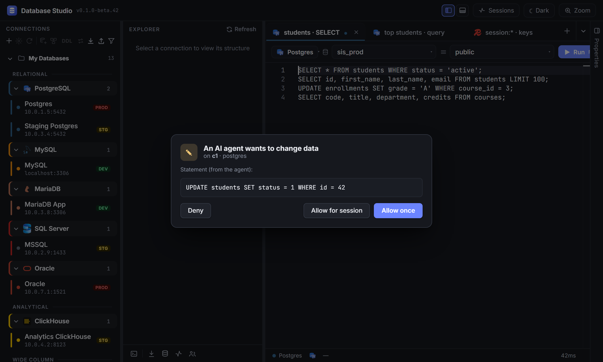

Agents get six tools — `list_connections`, `list_schemas`, `list_tables`, `describe_table`, `sample_rows` and `run_query`. Add it to a **local** agent, for example Claude Code:

```bash
claude mcp add --transport http database-studio \
  http://127.0.0.1:4319/mcp \
  --header "Authorization: Bearer <your-token>"
```

The server runs on your own machine, so a local agent can reach it; the browser version of an assistant runs on the provider's servers and cannot reach `127.0.0.1`.

### Transfer data between connections

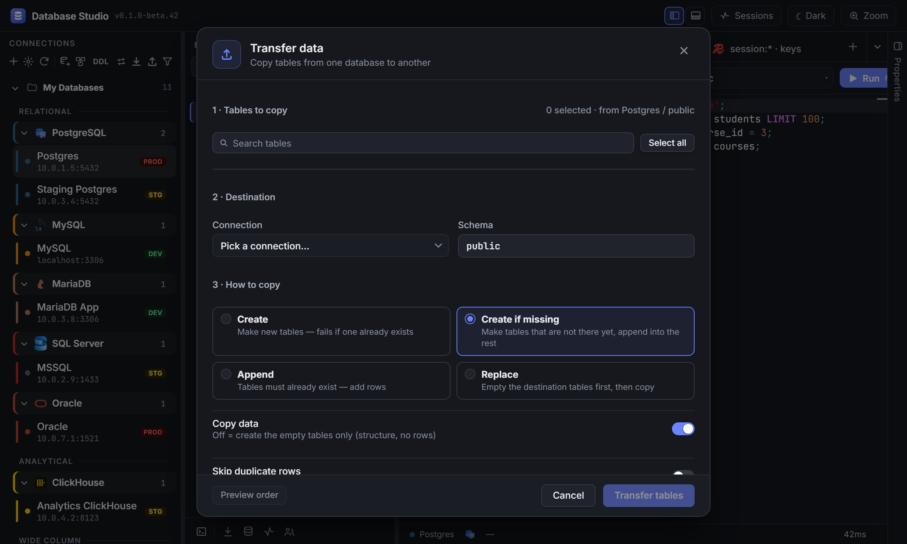

Copy many tables from one connection to another in a single pass — across different engines too. Pick the tables, a destination connection and schema, then how to copy:

- **Create** (fail if a table already exists), **Create if missing**, **Append** into existing tables, or **Replace** (empty them first).
- **Copy data** can be turned off to move only the structure.

Tables are ordered parent-before-child so foreign keys line up, and each one is verified by its row count after it copies.

### Compare data

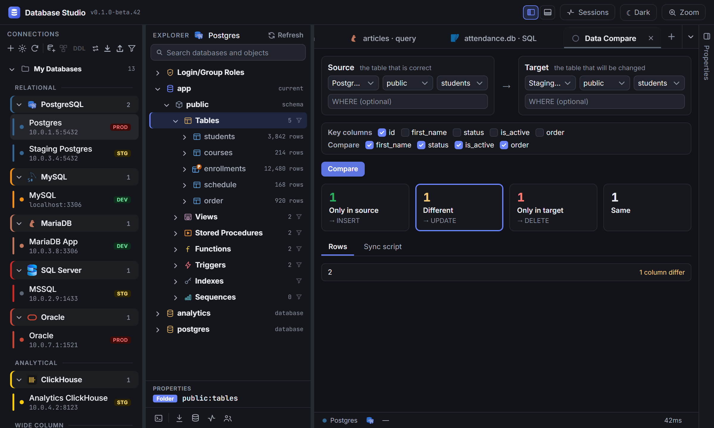

Compare the **rows** of two tables — in the same database or across connections. Choose the key columns and which columns to compare; rows are grouped into **Only in source** (→ INSERT), **Different** (→ UPDATE), **Only in target** (→ DELETE) and **Same**, with a per-row diff you can open. A ready-made **sync script** makes the target match the source — DELETE statements are left off until you ask for them, and applying to a connection tagged **PROD** asks you to type the table name first.

### Export and import connections

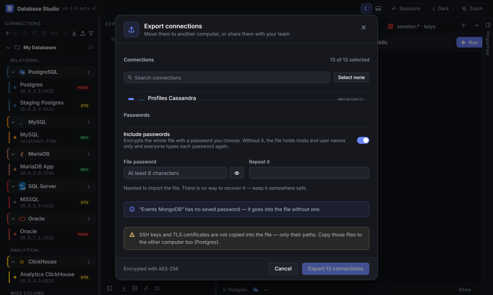

Move your connections to another computer or share them with your team. Export writes a single file; tick **Include passwords** to seal the whole file with a passphrase (AES-256) so the passwords travel with it — otherwise the file holds only hosts and user names and each password is typed again on the other side. SSH keys and TLS certificates are referenced by path, not copied, so bring those files along too.

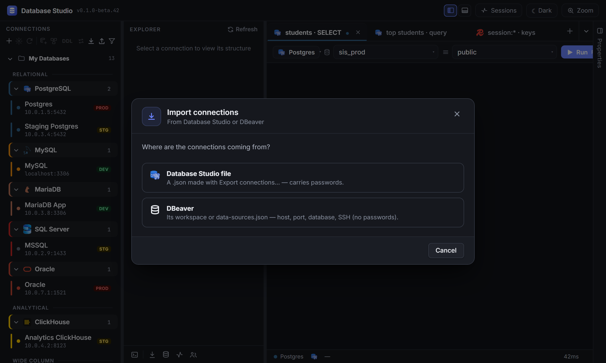

Import from a Database Studio file, or straight from **DBeaver** (point it at the workspace or its `data-sources.json` — hosts, ports, databases and SSH come across; DBeaver keeps passwords encrypted separately, so those are asked for on first connect). Every connection is reviewed before anything is added — **keep yours**, **update**, or **add a copy** — and anything already present is matched so you don't end up with duplicates.

### Also included

- **Command Palette** (`Ctrl+P`) to jump to connections, tables and commands.
- **Generate Scripts** for a whole schema (structure, data or both), including indexes and foreign keys.
- **Import** from CSV or JSON, **Copy Table to…** another connection, and **Generate Test Data** that respects foreign keys and unique constraints.
- **Session Monitor** to see and kill running sessions, and an **Index Scanner** that flags unused and missing indexes.
- Light and dark themes, an adjustable interface size, and two sidebar layouts: **Connections | Explorer** side by side, or **One sidebar** where each connection's tree opens right under it.

---

## Install

1. Open the repository's **[Releases](../../releases)** page and download the installer for your platform:
   - **Windows:** the `.exe` (NSIS) installer
   - **Ubuntu / Debian:** the `.deb` or the `.AppImage`. See also [INSTALL-UBUNTU.md](INSTALL-UBUNTU.md).
   - **macOS:** the universal `.dmg`
2. **macOS only:** the app is unsigned, so run this once before the first launch:
   ```bash
   xattr -cr "/Applications/Database Studio.app"
   ```
3. **Updates:** the app checks for a new version at startup. You can also check by hand in **Settings → Updates → Check for updates**. On Linux, only the AppImage updates itself; reinstall the `.deb` by hand.

The installer ships the client tools that Backup & Restore uses (`pg_dump`, `mariadb-dump`, `mongodump`, Oracle Data Pump and so on), so there is nothing else to install.

---

## Keyboard shortcuts

| Key | Action |
|---|---|
| `Ctrl+Shift+N` | New connection |
| `Ctrl+P` | Command Palette |
| `Ctrl+T` / `Ctrl+N` | New query tab |
| `F5` | Run the whole script |
| `Ctrl+Enter` | Run the statement at the cursor |
| `Ctrl+Shift+E` | Explain (query plan) |
| `Ctrl+Shift+F` | Format SQL |
| `Ctrl+Space` | Suggest tables, columns and functions |
| `Ctrl+S` | Save the query to a `.sql` file (in the Table Designer: save the table) |
| `Esc` | Cancel the running query |

On macOS, use `⌘` in place of `Ctrl`. The full list is in **Settings → Shortcuts**.

**Explorer tips:** double-click a database or schema to expand it; double-clicking a database name also opens the **Objects** tab, which lists its tables with row counts and sizes. Right-click any node for its actions.

---

## Running from source

### Prerequisites
| Tool | Notes |
|---|---|
| **Node.js 20+** | |
| **Rust** (stable, via [rustup](https://rustup.rs)) | |
| **CMake** | Needed to build `librdkafka` (Kafka). On Windows it ships with Visual Studio 2022. |
| **Windows** | Visual Studio 2022 Build Tools with the "Desktop development with C++" workload |
| **Ubuntu** | `sudo apt install libwebkit2gtk-4.1-dev libgtk-3-dev librsvg2-dev libayatana-appindicator3-dev libcurl4-openssl-dev build-essential file patchelf` |
| **macOS** | Xcode Command Line Tools (`xcode-select --install`) |

> **The first Rust build takes about 20–30 minutes** because it compiles DuckDB (C++) and librdkafka. Later builds take a few minutes.

### Desktop app
```bash
npm install
npm run tauri dev        # run from the repository root
```

### UI only, in a browser (no Rust needed)
```bash
npm install
npm run dev              # open http://localhost:5173
```
In a browser the app runs in **demo mode**: every backend call is answered by `src/lib/demo.ts`, which comes with sample data. This is the quickest way to work on the UI, and it is also the mode the Vitest and Playwright tests run in.

### Windows: cargo on PATH
In Git Bash, `cargo` and CMake may not be on `PATH`:
```bash
export PATH="$PATH:$HOME/.cargo/bin:/c/Program Files/Microsoft Visual Studio/2022/Community/Common7/IDE/CommonExtensions/Microsoft/CMake/CMake/bin"
```

### Bundled backup tools (optional)
Installers include `pg_dump`, `mariadb-dump`, `mongodump`, the Oracle Instant Client and similar tools. To get them when running from source:
```bash
npm run tools:fetch      # downloads, verifies SHA-256 and unpacks into src-tauri/resources/
```
Without this step, Backup & Restore uses whatever client tools are installed on your machine.

---

## Checks before committing

```bash
npm run check            # svelte-check + tsc — must report 0 errors / 0 warnings
npx vitest run           # frontend unit tests
npx playwright test      # UI tests (starts Vite automatically)
npm run tokens:check     # rejects hard-coded colors and spacing in components
```

Rust tests:
```bash
cd src-tauri
cargo test --lib                                   # unit tests (no database needed)
cargo test --test drivers_integration <test_name>  # integration tests — needs Docker
```
Integration tests use **testcontainers** to run real databases in Docker. Cassandra, SQL Server and ClickHouse containers are slow to start (1–3 minutes). Oracle tests need the Oracle Instant Client.

---

## Project layout

```
src/                      Svelte 5 frontend
  lib/ipc.ts              Single entry point to the backend (real Tauri, or demo in a browser)
  lib/demo.ts             Mock backend for the browser and the tests
  lib/stores/             State (runes): connections, tabs, results, explorer, ui…
  lib/components/         UI: explorer, workspaces, dialogs, grid…
  lib/sql/                Pure logic: statement splitting, DDL generation, autocomplete…
src-tauri/                Rust backend
  src/drivers/            One module per engine, unified in the LiveConnection enum (mod.rs)
  src/commands/           #[tauri::command] handlers (must be registered in lib.rs)
  src/connections/        Connection registry, SSH tunnels, query cancellation, keepalive
  src/storage/            Internal SQLite: connection profiles (passwords AES-256-GCM encrypted), tabs, history
  tests/                  Integration tests against real databases
tests/visual/             Playwright end-to-end tests
tools/fetch-dump-tools/   Build-time fetcher for the bundled client tools
spec/                     UI design prototype (the source of truth for the UI)
docs/screenshots/         The images used in this README
```

A few conventions that matter:
- **A new backend command** must be registered in `invoke_handler!` (`src-tauri/src/lib.rs`) **and** get a matching case in `src/lib/demo.ts`, or the browser-based tests break.
- **A new engine** needs a module in `drivers/`, a `LiveConnection` variant, and an arm in every `match` in `drivers/mod.rs`.
- **UI colors and spacing** come from tokens (`src/lib/tokens.css`, `src/lib/theme.css`). Do not hard-code hex values in components.

More detail: [CLAUDE.md](CLAUDE.md) (architecture and a log of past changes, mostly in Vietnamese), the `SPEC-*.md` files (one per feature), and [SPEC-INDEX.md](SPEC-INDEX.md).

---

## Releasing

```bash
npm run beta:bump                      # bumps the beta number in package.json and tauri.conf.json
git commit -am "chore: bump v0.1.0-beta.N"
git tag v0.1.0-beta.N && git push --follow-tags
```
Pushing a `v*` tag runs [build-beta.yml](.github/workflows/build-beta.yml). It builds for Windows, Ubuntu and macOS, creates a GitHub Release, signs the update artifacts and generates the `latest.json` manifest used by auto-update. The repository needs the **`TAURI_SIGNING_PRIVATE_KEY`** secret; without it the build fails.
